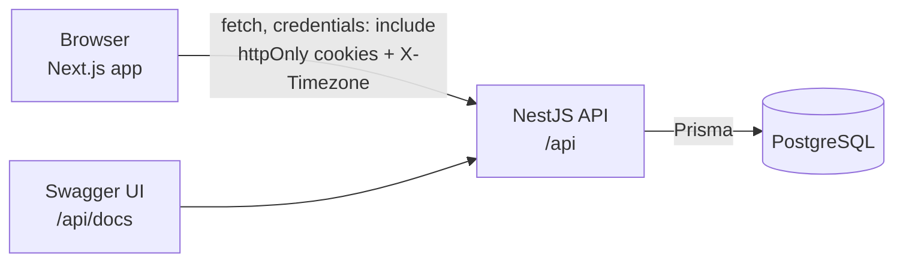
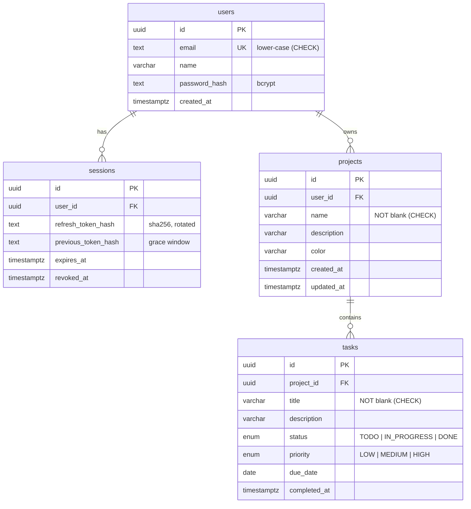
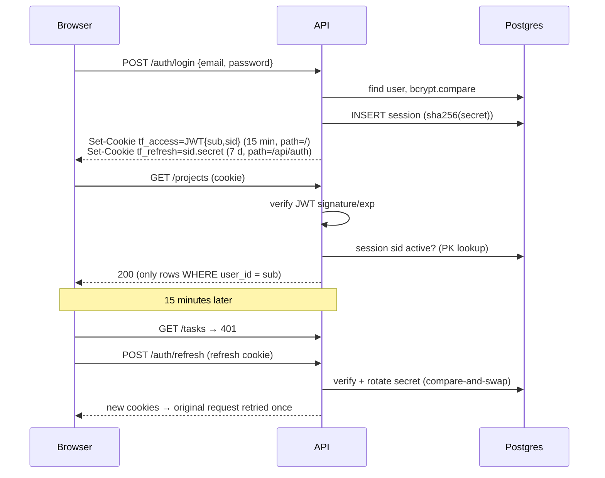

# TaskFlow: Architecture Note

This note covers the stack, the database design, how authentication works, and the main technical decisions with their trade-offs.

## 1. Overview



| Layer | Choice | Why |
| --- | --- | --- |
| Frontend | **Next.js 15 (App Router) + React 19** | Required by the brief. App Router layouts give clean auth/app route groups |
| Server state | **TanStack Query** | Caching, request deduplication, background refetch, optimistic updates and retries, with no hand-written reducers |
| Client state | **React Context** (auth, theme, UI overlays) + **URL search params** (filters, open task) | Only a little state is truly global. Anything worth sharing (filters, `?task=` deep links) lives in the URL |
| Forms | react-hook-form + zod | Uncontrolled inputs (few re-renders). Schemas mirror the API rules for instant feedback |
| Styling | Tailwind CSS | A consistent design-token scale. Small reusable components in `components/ui` |
| Backend | **NestJS 11** | Modules, DI and decorators give a clear controller → service → data layering, and guards, pipes and filters for cross-cutting concerns |
| ORM | **Prisma 6** | Type-safe queries, versioned SQL migrations, readable schema |
| Database | **PostgreSQL 16** | Relational data with strong integrity: FKs, cascades, CHECKs, enums, trigram indexes |

The backend is organized by feature (`auth`, `projects`, `tasks`, `dashboard`), with shared concerns in `common/`. Controllers only parse HTTP input and delegate. All business rules, including ownership, live in services.

## 2. Database design



Key choices:

- **Tasks have no `user_id` column.** Ownership comes from `task → project → user`, so a task cannot disagree with its project's owner. The cost is a join on task queries. It is indexed and cheap at this scale. If task volume grew a lot, I would denormalize `user_id` onto tasks and enforce consistency with a composite foreign key `(project_id, user_id)`.
- **`due_date` is a `DATE`, not a timestamp.** "Due on the 18th" is a calendar concept. A timestamp would bring timezone ambiguity (see §4.3).
- **Postgres enums** for status and priority. The database rejects invalid values, and enum order makes `ORDER BY priority` sort LOW < MEDIUM < HIGH with no CASE expression.
- **`ON DELETE CASCADE`** from users → projects → tasks and users → sessions, so deleting a project removes its tasks atomically.
- **`completed_at`** is set when a task moves to DONE and cleared when it leaves. It costs nothing now and enables future "completed this week" metrics.
- **CHECK constraints** (non-blank names and titles, lower-case emails) back up API validation in case a future code path skips it.

### Indexes

| Index | Serves |
| --- | --- |
| `projects (user_id, created_at DESC)`, `(user_id, updated_at DESC)` | Owner-scoped project lists in both sort orders |
| `tasks (project_id, status)` | Per-project status counts, status filters, dashboard grouping |
| `tasks (project_id, due_date)` | Overdue and "upcoming" queries, due-date sorting |
| `tasks USING GIN (title gin_trgm_ops)`, same on `projects.name` | Case-insensitive substring search (`ILIKE '%term%'`), which a B-tree cannot serve |
| `sessions (user_id)`, `users (email)` UNIQUE | Session lookup, login |

### Example query: per-project progress without N+1

The project list shows *total / done / overdue / progress* for every card. Instead of 2 count queries per project, `ProjectsService.statsFor()` runs **two grouped queries for the whole page**:

```sql
-- 1) counts by project and status
SELECT project_id, status, COUNT(*) FROM tasks
WHERE project_id = ANY($page_ids) GROUP BY project_id, status;

-- 2) overdue counts
SELECT project_id, COUNT(*) FROM tasks
WHERE project_id = ANY($page_ids) AND status <> 'DONE' AND due_date < $today
GROUP BY project_id;
```

Both use the `(project_id, status)` / `(project_id, due_date)` indexes, and the results are merged in memory. The dashboard works the same way: `COUNT`/`GROUP BY` queries run inside one read transaction, so the four headline numbers always agree with each other.

### Completions per day in the user's timezone (and a production bug)

The 14-day activity chart buckets `completed_at` (a `timestamptz`) by the *user's* calendar day. A task finished at 23:30 in Kolkata belongs to that day even though it is 18:00 UTC.

The first version did the bucketing in SQL with `(completed_at AT TIME ZONE $tz)::date`. It passed every test locally, then returned **500 in production**: Chrome reported the timezone as `Asia/Calcutta` (a legacy alias), and the Railway database (PostgreSQL 18 on Debian 13) no longer ships legacy timezone aliases, so Postgres rejected a name Node.js accepts. The local PostgreSQL 16 (Alpine) still had the alias, which hid the problem.

The fix removes the dependency on the database's timezone list. The query fetches only the completion timestamps inside the window, widened by a day on each side to cover any UTC offset (a handful of rows), and Node buckets them with `Intl.DateTimeFormat`, the same timezone logic that already validates the header:

```ts
const rows = await prisma.task.findMany({
  where: { project: { userId }, status: 'DONE', completedAt: { gte: since - 1 day, lt: today + 2 days } },
  select: { completedAt: true },
});
// bucket each timestamp into YYYY-MM-DD in the caller's timezone, then zero-fill 14 days
```

Regression tests pin `Asia/Calcutta` (unit and e2e), and CI now runs the backend suite against **both PostgreSQL 16 and 18**, so the engine production uses is always tested.

## 3. Authentication & authorization



- **Passwords** are hashed with bcrypt, cost 12 (configurable). Login always runs a bcrypt comparison, against a dummy hash for unknown emails, so response time does not reveal which emails exist. Both failure cases return the same 401 message.
- **Access token:** an HS256 JWT valid for 15 minutes, carrying `sub`, `email` and `sid` (session id), with issuer and audience checked. It is sent as an httpOnly cookie for the browser, or as `Authorization: Bearer` for API clients.
- **Refresh token:** an opaque `"<sessionId>.<48 random bytes>"` in an httpOnly cookie **scoped to `/api/auth`**, so it is never sent to data endpoints. Only its SHA-256 hash is stored.
  - **Rotation:** every refresh issues a new secret. The rotation is a compare-and-swap (`UPDATE … WHERE refresh_token_hash = old`), so two concurrent refreshes cannot both succeed against the same old token.
  - **Reuse detection:** presenting an already-rotated token means it was copied, so the whole session is revoked.
  - **Grace window (30 s):** two tabs that refresh at the same moment would otherwise trip reuse detection and log the user out. The previous hash is accepted briefly to handle this race. *This edge case surfaced while designing for multiple tabs, and is covered by a test.*
- **Logout takes effect immediately.** The guard checks that the token's `sid` is still active (one primary-key lookup per request). Logout therefore invalidates all tokens of that session at once, instead of leaving them valid until the JWT expires. I chose this over pure stateless JWTs because the brief asks for real invalidation, and the lookup is cheap.
- **Authorization:** a global `JwtAuthGuard` protects every route by default (opt out with `@Public()`), so a new endpoint cannot be left open by accident. Ownership is enforced **inside the query** (`WHERE id = $1 AND user_id = $me`, or `project: { userId }` for tasks), never by fetching first and comparing afterwards. Another user's resource returns **404 rather than 403**, so their IDs cannot be probed. Moving a task to another project re-checks ownership of the destination.
- **Why cookies, not localStorage:** httpOnly cookies cannot be read by injected scripts, so XSS cannot steal tokens. CSRF is mitigated by `SameSite=Lax`, a strict CORS allowlist with credentials, and JSON-only mutation endpoints. A cross-site deployment would add a CSRF token (see the README limitations).
- **Defense in depth:** helmet headers; validation that rejects unknown properties (blocks mass assignment such as sending `userId`); UUID checks on path parameters; a 10 requests/minute/IP throttle on credential endpoints; and environment validation that refuses weak secrets at boot.

## 4. Other key decisions

### 4.1 Consistent errors and observability
A single `AllExceptionsFilter` turns every error into `{ statusCode, error, message, details?, path, timestamp, requestId }`. Validation errors list each invalid field. Prisma's unique-violation and not-found errors map to 409 and 404. Anything unexpected becomes a generic 500, and only the server log keeps the stack trace. A middleware assigns each request an id (or accepts a well-formed `X-Request-Id`), echoes it in the response header, and writes one access-log line per request with status and duration.

### 4.2 Same-origin API proxy
The browser never calls the API host directly. `frontend/src/app/api/[...path]/route.ts` forwards `/api/*` to `API_PROXY_TARGET`, which is read at runtime: `http://api:4000` in Compose, a private-network URL in production. It passes cookies, the client IP and every `Set-Cookie` through.

This came from a real deployment bug. On Railway the web app and API got two `*.up.railway.app` domains, and that suffix is on the Public Suffix List, so they are *different sites*. Login returned 200, but the browser treated the API's cookies as third-party and never sent them back, so every request after it was a 401. `SameSite=None` would have weakened CSRF protection and still fails in browsers that block third-party cookies. The proxy makes the cookies first-party, removes CORS from the picture and keeps `SameSite=Lax`.

### 4.3 Frontend data flow
- One `api()` wrapper handles credentials, JSON, the `X-Timezone` header and error mapping. On a 401 it runs a **single-flight refresh**: ten requests that fail together share one refresh call, then retry.
- Query keys are hierarchical (`['tasks', 'list', params]`), so a task mutation can invalidate *all* task lists, project stats and the dashboard in one call.
- Status changes are **optimistic**: the card moves immediately, the cache snapshot is restored on error, and the server's version is refetched afterwards.
- Mutation errors surface through one global `MutationCache.onError` toast. Forms additionally map `details[]` onto their fields.

### 4.4 Overdue depends on the user's "today"
"Overdue" means *not done and due before today*. Today is not the same everywhere: at 01:00 in Kolkata it is still yesterday in UTC. The browser sends its IANA timezone in `X-Timezone`, the API works out today's date in that zone (falling back to UTC for missing or invalid values), and every overdue calculation uses it. A unit test pins this behaviour at a timezone boundary, and an e2e test exercises it with UTC+14.

### 4.5 UI architecture and design system
- **Design tokens as CSS variables.** The neutral `ink` scale, surfaces and the `brand` accent are RGB triplets on `:root`. Dark mode (`.dark`) redefines the neutrals, and `data-accent` swaps the brand ramp. Tailwind reads them through `rgb(var(--x) / <alpha-value>)`, so one class (`bg-surface`, `text-ink-900`, `bg-brand-500/10`) works in every theme and accent, and components contain no `dark:` duplication for neutrals.
- **No theme flash.** A tiny inline script in `<head>` applies the stored mode and accent before first paint. The `ThemeProvider` initialises from the same storage, so React never toggles the class after mount.
- **Validated chart colours.** The status hues (orange / blue / emerald) were run through a palette validator for lightness band, chroma, colour-blind separation and contrast against both light and dark surfaces. A first attempt with slate/sky failed, so the palette changed. Charts are never colour-only: legends with counts and percentages, labelled bars, and sr-only data tables.
- **One overlay host.** The task drawer, create dialogs and command palette are rendered once in the app shell and opened through a `UIProvider`, so pages, the palette and keyboard shortcuts share one implementation. The open task is just `?task=<id>` in the URL: shareable and survives a refresh.
- **Board grouping is data-driven.** `buildColumns(groupBy)` returns columns that each carry the *patch* a drop applies (`{status}`, `{priority}` or `{projectId}`). Drag-and-drop, quick-add and tests all go through that one abstraction, and the server still validates ownership when a task changes project.

### 4.6 Shared app setup for tests
`configureApp()` (prefix, helmet, cookies, CORS, validation pipe, error filter) is used by both `main.ts` and the e2e tests. The integration tests therefore exercise the exact production pipeline against a real Postgres database, not mocks.

### 4.7 Delivery
- Multi-stage Dockerfiles. The API image runs as a non-root user with `tini`, applies `prisma migrate deploy` on start, and can seed demo data. The web image uses Next.js standalone output.
- Compose health checks order start-up: db healthy → api healthy (it checks the database) → web.
- CI runs lint, typecheck, build, unit tests and e2e tests (Postgres service container) for the backend, and lint, typecheck, tests and build for the frontend. It then builds both Docker images.
- The OpenAPI spec and Postman collection are generated from the code (`npm run openapi:export`), so the API docs can't drift from the implementation.

## 5. Pitfalls handled along the way

- **`"false"` read as `true`:** a naive `@Type(() => Boolean)` turns the string `"false"` into `true`, which would have silently enabled `COOKIE_SECURE` and broken login over plain HTTP locally. The environment loader parses booleans explicitly, and a test covers it.
- **Pagination drift:** sorting only by `dueDate` or `priority` (non-unique) can repeat or skip rows between pages. Every list query adds `createdAt` and `id` tie-breakers.
- **Board vs. list:** a paginated board would hide cards in arbitrary columns. The board loads up to 200 filtered tasks and says so when there are more. The list view is fully paginated.
